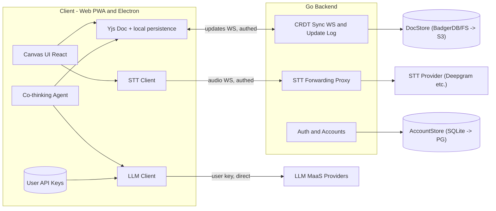
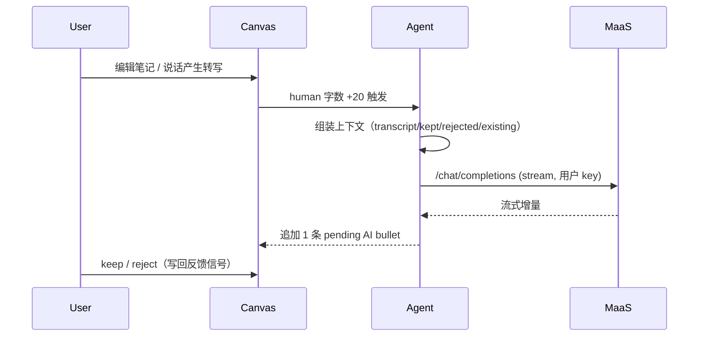
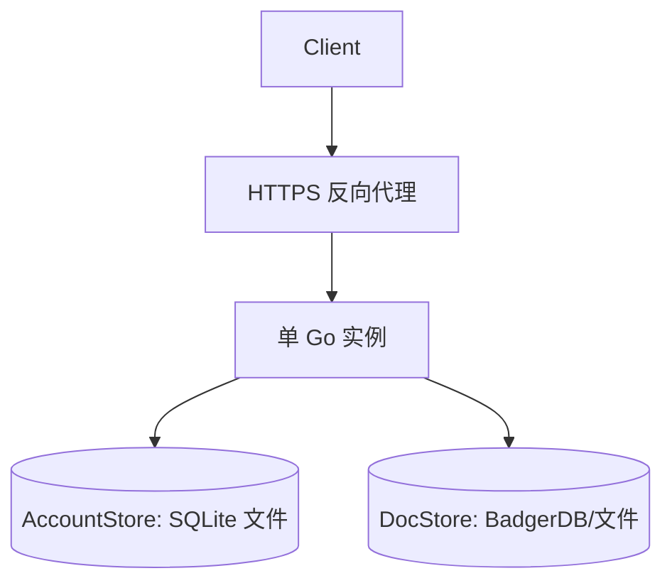
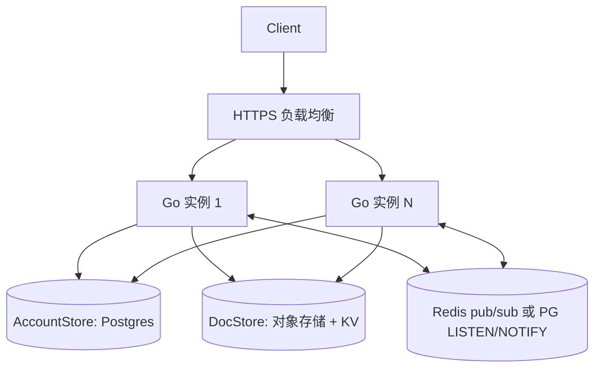

# 02 · 系统架构

[← 返回索引](../technical-plan.md)

## 2.1 目标架构总图

> 存储分两套：账号/业务用 `AccountStore`（MVP SQLite），CRDT 同步用 `DocStore`（MVP BadgerDB/文件）。MVP 全嵌入式，单二进制无外部 DB。详见模块 04。

## 2.2 职责边界

- **客户端**：全部 UI、CRDT 文档与本地持久化、LLM 直连、co-thinking agent、STT 采集与展示。
- **Go 后端**：账号体系、CRDT 同步中继与持久化、STT 转发（带账号识别/记账钩子）。
- **不经后端**：LLM 推理、（初期）Web 搜索。

## 2.3 三条主数据流

### A. 思考流（LLM，前端闭环）

### B. 同步流（CRDT，经后端中继）

见模块 05。要点：客户端本地先写，异步同步；后端仅中继 + 持久化，不理解 CRDT 内部。

### C. 语音流（STT，经后端转发）

见模块 07。要点：客户端麦克风 → WS → Go → 上游 STT → 回传转写 → 喂给 transcript 与 agent。

## 2.4 部署拓扑

### MVP：单实例、全嵌入式（推荐起步）

- 无外部 DB 服务，一个二进制 + 两个本地数据目录即可跑起来。
- 反向代理需支持 WebSocket 升级与长连接。

### 规模化：多实例 + 独立存储（后期）

- **多实例注意**：CRDT 同步是有状态的 WS 广播。多实例下需实例间广播（Redis pub/sub 或 PG `LISTEN/NOTIFY`），或用一致性哈希把同一 `docId` 路由到同一实例（见模块 05）。
- **STT WS**：无跨实例状态，随连接落在任一实例即可。
- 账号与 CRDT 存储始终保持分离（不同实例/服务）。

## 2.5 技术栈总览

| 层 | 选型 |
| --- | --- |
| 客户端框架 | React 18 + Vite（沿用现有） |
| CRDT | Yjs（`y-indexeddb` / Electron 端 `y-leveldb`） |
| 桌面壳 | Electron（`electron-vite`） |
| 后端语言 | Go |
| 后端路由 | chi / gin |
| WebSocket | nhooyr.io/websocket 或 gorilla/websocket |
| 账号存储（AccountStore） | MVP：SQLite（WAL）→ 规模化：Postgres（`pgx`） |
| CRDT 同步存储（DocStore） | MVP：文件系统（默认）→ BadgerDB → 规模化：对象存储（S3/MinIO）+ KV |
| 鉴权 | JWT（access + refresh），密码 argon2id |
| STT 上游 | Deepgram（备选 AssemblyAI / Gladia / Soniox） |
