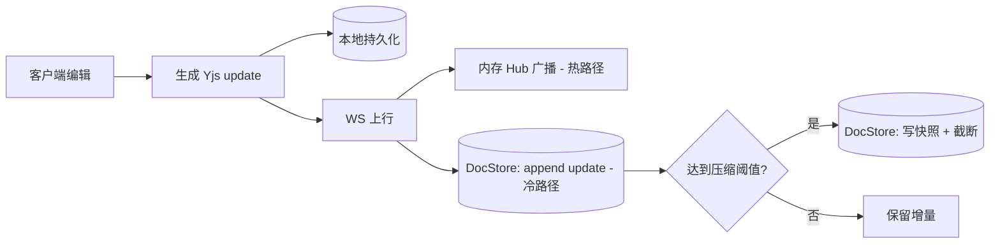

# 04 · 数据模型与存储

[← 返回索引](../technical-plan.md)

本模块定义"笔记格式"（客户端 CRDT 文档）与"存储方案"。存储上有一个关键决策：**账号/业务存储与笔记同步存储物理分离**，且 **MVP 阶段不使用 Postgres**，改用嵌入式存储，保持单 Go 二进制、零外部依赖。

## 4.1 设计原则

- **内容进 CRDT，临时 UI 态不进 CRDT。** 内容需要跨端同步与协作合并；UI 态（编辑中、选中、AI 运行中）是本地瞬态。
- **一个 board（画布）= 一个 Yjs 文档。** 用户可拥有多个 board。
- **Schema 版本化**：`meta.schemaVersion`，为后续格式迁移留口。
- **两类存储分离**：账号（关系型、小、事务、低写入）与 CRDT 同步（二进制 blob、append 为主、高写入）访问模式截然不同，藏在 `AccountStore` / `DocStore` 两个接口后各选引擎、各自扩展。

## 4.2 CRDT 文档结构（Yjs）

**一个 board = 一次思考会话 = transcript + 画布笔记**，两者同属一个 Yjs 文档、一起持久化与同步。transcript 不是临时上下文，而是会话的核心资产（且现有原型里 transcript 段落可就地编辑）。

```text
doc
├─ meta       : Y.Map    { title: string, createdAt: number, schemaVersion: number }
├─ transcript : Y.Array<Y.Map>            // 有序的“定稿”转写段落（interim 不入）
│                ├─ id       : string
│                ├─ text     : Y.Text      // 可就地编辑、协作合并
│                ├─ tStart   : number      // 相对会话起点的毫秒
│                ├─ tEnd     : number
│                ├─ lang     : string       // STT 返回的语种（自动）
│                ├─ speaker? : string       // 预留（多说话人/后期）
│                └─ marks?   : Y.Array<{ start, end, label? }>  // 关键词高亮范围
└─ notes      : Y.Map<noteId, Y.Map>
                ├─ x        : number
                ├─ y        : number
                ├─ keyword  : string
                ├─ srcSeg?  : string        // 溯源：由哪条 transcript 段落拖拽而来
                ├─ bullets  : Y.Array<Y.Map>
                │              { id: string,
                │                origin: 'human' | 'ai',
                │                text: Y.Text,
                │                status: 'pending' | 'kept',
                │                fireId?: string }
                ├─ cards    : Y.Array<Y.Map>
                │              { id, title, url, snippet?, image?, status }
                ├─ kept     : Y.Array<string>
                └─ rejected : Y.Array<string>
```

### transcript 设计要点

- **只持久化定稿（final）段落**：STT 的 interim（实时灰字）是本地瞬态，不入 CRDT；某段 `final` 时才 append 到 `transcript`（模块 07）。
- `text` 用 `Y.Text`：支持用户就地纠正转写错误，并可多端/多人协作合并（对应现有 "Edit transcript sections in place"）。
- `marks`：关键词高亮范围（现有 `<mark className="kw">` 的可拖拽短语），可由客户端规则或 agent 标注；纯本地阶段可省略、运行时派生。
- `notes[].srcSeg`：可选溯源，记录某 note 由哪条 transcript 段落拖拽而来，便于双向定位（点 note 跳到来源、点段落看衍生笔记）。
- **体量与压缩**：长会话下 `transcript` 会增长，但与画布共用同一套快照压缩机制（模块 05）即可控制 update 日志体积；若单会话超长（如数小时连续语音），可选升级为"transcript 独立 Yjs 文档"（见 4.2b）。

### 4.2b 可选：超长会话拆分文档

默认 transcript 与画布同文档（原子同步、模型简单）。当出现超长连续语音导致文档过大时，可拆成两个 Yjs 文档：`board:<id>:canvas` 与 `board:<id>:transcript`，各自同步与压缩，`notes[].srcSeg` 跨文档引用段落 id。首版不拆，作为规模化预案。

### 进 / 不进 CRDT 对照（对照现有 `canvas-types.ts`）

| 字段 | 现状（`KeywordNote`） | 归属 |
| --- | --- | --- |
| `x` / `y` | 顶层 | CRDT |
| `keyword` | 顶层 | CRDT |
| `bullets[].text/origin/status/fireId` | 顶层 | CRDT |
| `cards[]` | 顶层 | CRDT |
| `kept` / `rejected` | 顶层 | CRDT |
| `keywordEditing` | 顶层 | **本地态**（React state） |
| `bullets[].editing` | 顶层 | **本地态** |
| `aiRunning` | 顶层 | **本地态** |
| `lastFiredWords` | 顶层 | **本地态**（触发器计数） |
| `selectedIds` / `marquee` | App 顶层 | **本地态**（多人协作用 awareness） |
| transcript **定稿段落** | `Transcript.tsx` 静态 `LINES` | CRDT（`transcript`） |
| transcript **interim（实时灰字）** | — | **本地态**（未定稿不入 CRDT） |
| `录音中(recording)` | `App.tsx` 顶层 | **本地态** |

### 关于 `bullets[].text` 用 Y.Text

- `Y.Text` 支持多人对同一 bullet 细粒度并发编辑与合并。
- 纯本地阶段可先用 `string` 降低复杂度，Schema 升级时迁移到 `Y.Text`（借 `schemaVersion` 迁移函数）。

## 4.3 TypeScript 视图类型（从 Yjs 派生）

渲染层沿用类似现有接口，作为"从 CRDT 派生的只读投影 + 本地 UI 态叠加"：

```ts
// packages/core/model.ts
export interface BoardView {
  transcript: TranscriptSegmentView[]   // 定稿段落（CRDT）
  interim?: string                      // 实时灰字（本地态，未定稿）
  notes: NoteView[]
}

export interface TranscriptSegmentView {
  id: string
  text: string
  tStart: number
  tEnd: number
  lang: string
  speaker?: string
  marks?: { start: number; end: number; label?: string }[]
  editing?: boolean // 本地态：就地编辑中
}

export interface NoteView {
  id: string
  x: number
  y: number
  keyword: string
  srcSeg?: string          // 溯源到 transcript 段落
  bullets: BulletView[]
  cards: CardView[]
  kept: string[]
  rejected: string[]
  // 本地 UI 态（不在 CRDT）
  keywordEditing?: boolean
  aiRunning?: boolean
  lastFiredWords?: number
}

export interface BulletView {
  id: string
  origin: 'human' | 'ai'
  text: string
  status: 'pending' | 'kept'
  fireId?: string
  editing?: boolean // 本地态
}

export interface CardView {
  id: string
  title: string
  url: string
  snippet?: string
  image?: string
  status: 'pending' | 'kept'
}
```

## 4.4 本地持久化

- **Web**：`y-indexeddb`，文档随开随存，离线可用。
- **Electron**：`y-leveldb` 或文件持久化，支持离线打开与更大容量。
- 本地存"文档二进制（Yjs update）"，与后端存储格式一致，便于双向同步。

## 4.5 后端存储：两个分离的 Store

后端把持久化抽象成两个接口，业务逻辑只依赖接口，不绑定具体引擎：

```go
// 账号/业务：小、关系型、事务、低写入
type AccountStore interface {
    CreateUser(ctx, email, passwordHash string) (User, error)
    GetUserByEmail(ctx, email string) (User, error)
    SaveRefreshToken(ctx, userID, tokenHash string, exp time.Time) error
    RevokeRefreshToken(ctx, tokenHash string) error
    // 文档元信息（归属/标题/协作）也属账号侧
    CreateDocument(ctx, ownerID, title string) (Document, error)
    ListDocuments(ctx, ownerID string) ([]Document, error)
    CanAccess(ctx, userID, docID string) (bool, error)
}

// CRDT 同步：二进制 blob、append 为主、高写入
type DocStore interface {
    AppendUpdate(ctx, docID string, update []byte) (seq int64, err error)
    LoadSince(ctx, docID string, seq int64) (updates [][]byte, err error)
    PutSnapshot(ctx, docID string, snap, stateVector []byte, version int64) error
    LatestSnapshot(ctx, docID string) (snap, sv []byte, version int64, err error)
    TruncateUpdates(ctx, docID string, throughSeq int64) error
}
```

### 引擎选择：MVP → 规模化

| Store | MVP（推荐） | 规模化 | 说明 |
| --- | --- | --- | --- |
| `AccountStore` | **SQLite（WAL）** | Postgres | 小、事务、低写入；嵌入式零运维 |
| `DocStore` | **BadgerDB** 或 文件系统 | 对象存储（S3/MinIO）+ KV | blob、高写入；SQLite 单写锁不适合，故与账号分开 |

- MVP：两个都嵌入式 → 单 Go 二进制，无需部署任何外部 DB。
- 规模化：`AccountStore` 换 Postgres，`DocStore` 快照进对象存储、近期增量留 KV/PG，或整体切 y-sweet/Hocuspocus（模块 05）。

**`DocStore` 起步阶梯（可按需渐进，接口不变）：**

1. **文件系统**（最省）：连 Badger 依赖都省，`data/<docId>/` 下放快照 + 增量文件；调试直观、可直接备份/拷贝。适合早期单实例、并发低。
2. **BadgerDB**：当出现"大量小 update 高频写、目录 inode/小文件过多、需要更好的读写吞吐与原子性"时切换。
3. **对象存储 + KV**：规模化 / 多实例时，快照进 S3/MinIO、近期增量留 KV。

由于都实现同一个 `DocStore` 接口，切换只换实现、不动业务与同步逻辑（模块 06 `storage/` 下并列实现）。

### 账号侧数据（SQLite / 后期 Postgres）

字段与关系型建模一致（后期迁 PG 时几乎零改动）：

```sql
-- users:        id, email(unique), password_hash(argon2id), created_at
-- refresh_tokens: id, user_id, token_hash, expires_at, revoked
-- documents:    id, owner_id, title, created_at, updated_at
-- document_collaborators: doc_id, user_id, role(owner|editor|viewer)
-- usage_events(后期计费/限流，先建不启用): id, user_id, kind('stt'|'search'), amount, created_at
```

> 完整 PG 版 DDL 见附录 4.7（规模化时使用）。

### CRDT 侧数据（BadgerDB / 文件系统）

不是关系表，而是按 `docId` 组织的键空间 / 目录：

```text
# BadgerDB key 布局
doc/<docId>/snap                 -> 最新快照 { snapshot, stateVector, version }
doc/<docId>/upd/<seq>            -> 单条 Yjs update（append，seq 递增）

# 或文件系统布局
data/<docId>/snapshot.bin
data/<docId>/state_vector.bin
data/<docId>/updates/<seq>.bin
```

- append 一条 update = 写一个新 key/文件，天然 append-only。
- 回放 = 读 `snap` + 遍历 `> snapshot.version` 的 `upd/*`。
- 压缩 = 客户端上传新快照后，删旧 `upd/*`（`TruncateUpdates`）。

## 4.6 数据生命周期



- **热路径**（实时协作）在内存 Hub 完成，不阻塞于存储。
- **冷路径**（持久化）用于离线追赶、换设备、服务重启的回放，写入可异步/批量。

## 4.7 附录：规模化 Postgres DDL（后期）

当 `AccountStore` 迁到 Postgres、`DocStore` 也想用 PG 承载时，使用下述完整 DDL：

```sql
CREATE TABLE users (
  id            UUID PRIMARY KEY DEFAULT gen_random_uuid(),
  email         TEXT UNIQUE NOT NULL,
  password_hash TEXT NOT NULL,          -- argon2id
  created_at    TIMESTAMPTZ NOT NULL DEFAULT now()
);

CREATE TABLE refresh_tokens (
  id         UUID PRIMARY KEY DEFAULT gen_random_uuid(),
  user_id    UUID NOT NULL REFERENCES users(id) ON DELETE CASCADE,
  token_hash TEXT NOT NULL,
  expires_at TIMESTAMPTZ NOT NULL,
  revoked    BOOLEAN NOT NULL DEFAULT false
);

CREATE TABLE documents (
  id         UUID PRIMARY KEY DEFAULT gen_random_uuid(),
  owner_id   UUID NOT NULL REFERENCES users(id) ON DELETE CASCADE,
  title      TEXT NOT NULL DEFAULT 'Untitled',
  created_at TIMESTAMPTZ NOT NULL DEFAULT now(),
  updated_at TIMESTAMPTZ NOT NULL DEFAULT now()
);

CREATE TABLE document_collaborators (
  doc_id  UUID REFERENCES documents(id) ON DELETE CASCADE,
  user_id UUID REFERENCES users(id) ON DELETE CASCADE,
  role    TEXT NOT NULL DEFAULT 'editor',
  PRIMARY KEY (doc_id, user_id)
);

-- 若 DocStore 也用 PG（否则放 KV/对象存储）
CREATE TABLE document_updates (
  id         BIGSERIAL PRIMARY KEY,
  doc_id     UUID NOT NULL REFERENCES documents(id) ON DELETE CASCADE,
  seq        BIGINT NOT NULL,
  update     BYTEA NOT NULL,
  created_at TIMESTAMPTZ NOT NULL DEFAULT now()
);
CREATE INDEX idx_updates_doc_seq ON document_updates (doc_id, seq);

CREATE TABLE document_snapshots (
  doc_id       UUID NOT NULL REFERENCES documents(id) ON DELETE CASCADE,
  snapshot     BYTEA NOT NULL,
  state_vector BYTEA NOT NULL,
  version      BIGINT NOT NULL,
  created_at   TIMESTAMPTZ NOT NULL DEFAULT now(),
  PRIMARY KEY (doc_id, version)
);

CREATE TABLE usage_events (
  id         BIGSERIAL PRIMARY KEY,
  user_id    UUID NOT NULL REFERENCES users(id),
  kind       TEXT NOT NULL,
  amount     NUMERIC NOT NULL,
  created_at TIMESTAMPTZ NOT NULL DEFAULT now()
);
```

- 注意：即便迁 PG，也建议 `AccountStore` 与 `DocStore` 用**不同数据库/实例**，保持隔离。
- 快照大时 `document_snapshots.snapshot` 可改存对象存储，表内只留引用键。
