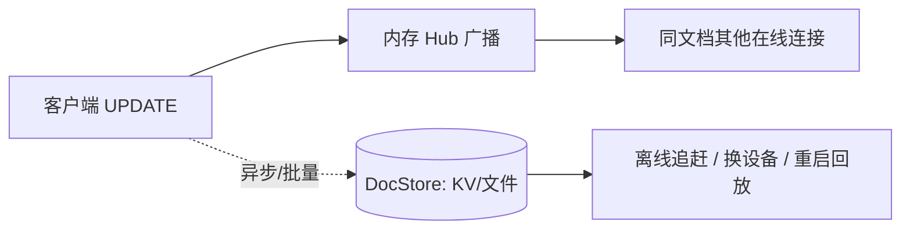
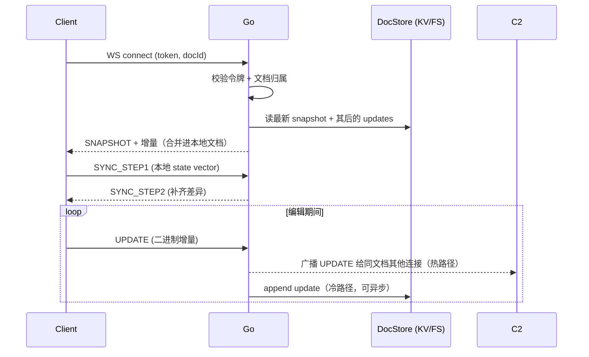
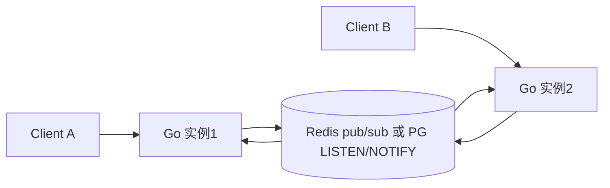

# 05 · 同步协议

[← 返回索引](../technical-plan.md)

目标：多端同步笔记，本地优先、离线可用、自动合并冲突。核心思想——**Go 后端只做"带持久化的哑中继"，不理解 CRDT 内部**。

> 关于"同步是否依赖数据库"：同步依赖的是**持久化**，不是**关系型数据库**。实时协作的热路径是纯内存 + WS 广播；持久化只服务于离线追赶、换设备、服务重启的回放，用 KV/文件（`DocStore`，模块 04）即可，**无需 Postgres**。

## 5.1 角色划分

- **客户端**：持有完整 Yjs 文档，负责合并、渲染、压缩快照。
- **Go 后端**：
  1. 校验连接（token + docId 归属）；
  2. 回放历史（快照 + 增量）给新连接；
  3. 接收客户端 update，追加到 `DocStore` 并广播给同文档其他连接。

## 5.1b 热路径 vs 冷路径



- **热路径**（实时协作）：内存 Hub 广播，低延迟，不阻塞于存储。
- **冷路径**（持久化）：写 `DocStore`，可异步/批量。
- 只有当"新设备登录需看到历史笔记"时才必须持久化——这是保留服务端存储的唯一硬性理由。

## 5.2 消息协议（WS 二进制帧）

在 `/sync/:docId` 上定义最小消息集（首字节为类型标签）：

```text
0x01 SYNC_STEP1   : 客户端发送本地 state vector（请求缺失增量）
0x02 SYNC_STEP2   : 服务端/对端回发对方缺失的 update
0x03 UPDATE       : 增量 update 广播（任意方产生编辑即发）
0x04 SNAPSHOT_PUT : 客户端上传合并后的快照（压缩）
0x05 AWARENESS    : 光标/选区等 awareness（不持久化，仅广播）
```

> 说明：Yjs 原生的 `y-protocols/sync` 已定义 step1/step2/update 语义。若采用 `y-websocket` 客户端协议，Go 端只需按该协议转发字节并持久化 `update`，无需解析 CRDT 语义。

## 5.3 连接与回放流程



## 5.4 离线与重连

- 离线时：编辑写入本地持久化（`y-indexeddb` / `y-leveldb`），UI 无感。
- 重连时：客户端与服务端交换 state vector，仅补齐差异增量；CRDT 自动合并，无需人工解决冲突。
- 多设备并发编辑：CRDT 保证最终一致，`kept`/`rejected` 等用 `Y.Array` 天然可并集合并。

## 5.5 快照压缩

- 触发：某 `docId` 在 `DocStore` 中的增量条数或字节超阈值。
- 执行方：**客户端**（服务端不懂 CRDT）——由持有完整文档的某客户端定期 `Y.encodeStateAsUpdate` 生成快照，经 `SNAPSHOT_PUT` 上传。
- 服务端：`DocStore.PutSnapshot(version+1)`，并 `TruncateUpdates` 截断该 `version` 之前的增量。

## 5.6 多实例扩展（后期）

单实例时广播在进程内内存完成即可。多实例时需跨实例广播：



- 方案 A：`docId` 一致性哈希路由到同一实例（无需 pub/sub）。
- 方案 B：Redis / Postgres `LISTEN/NOTIFY` 跨实例广播 update。
- 初期单实例即可，此为水平扩展预案。

## 5.7 备选方案

- **y-sweet**（Rust）/ **Hocuspocus**（Node）：现成的 Yjs 同步服务，带更智能的 diff 与持久化。
- 取舍：会引入非 Go 的独立服务，脱离"纯 Go 后端"目标；初期不采用，规模上来后可将同步职责外置、Go 只管 Auth 与业务。

## 5.8 权限校验

- 每个 `/sync/:docId` 连接握手时，通过 `AccountStore.CanAccess(user, docId)` 校验归属/协作（文档元信息在 `AccountStore`，CRDT 数据在 `DocStore`）。
- 广播只在同 `docId` 的已授权连接间进行。
