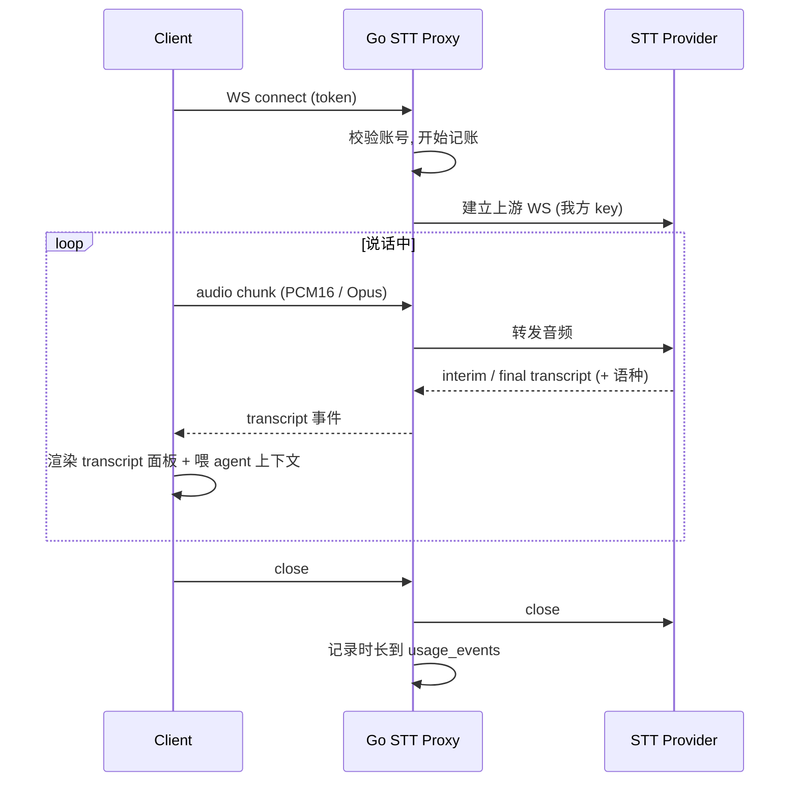

# 07 · STT 转发

[← 返回索引](../technical-plan.md)

用户自行配置 STT 服务困难，因此由后端统一持有厂商 key、按账号识别、为计费/限流留扩展点。这是后端唯一持有第三方 key 并可能产生成本的能力。

## 7.1 为什么走后端（而 LLM 不走）

| 对比 | STT | LLM |
| --- | --- | --- |
| 用户自配难度 | 高（实时流协议、鉴权复杂） | 低（填 baseURL + key 即可） |
| 密钥归属 | 我方（便于统一与计费） | 用户 |
| 成本控制 | 需按账号计量 | 用户自担 |
| 结论 | **后端转发** | **前端直连** |

## 7.2 上游选型

- 首选：**Deepgram**（实时流 WS、多语言/自动语种、延迟低、价格友好）。契合 AGENTS.md「输出语言跟随用户主导口语」。
- 备选：AssemblyAI（实时）、Gladia、Soniox。
- 批量转写（非实时）场景可用 Groq 的 `whisper-large-v3`，但不适合边说边转。

## 7.3 数据流



## 7.4 客户端采集

- `getUserMedia({ audio: true })` → `AudioWorklet` / `MediaRecorder` 取帧。
- 编码：优先 PCM16（16kHz 单声道）或上游支持的 Opus。
- 经 `/stt` WS 上行；接收 interim（灰字实时）+ final（定稿）。
- 定稿文本替换 `Transcript.tsx` 的静态占位（`LINES`/`TRANSCRIPT_TEXT`），并作为 agent 的 `transcriptWindow`（见现有 `App.tsx` 用法）。

## 7.5 服务端消息（`/stt`）

```text
上行:
  binary  audio 帧
  {"type":"config","language":"auto","sampleRate":16000}  可选起始配置
  {"type":"stop"}

下行:
  {"type":"transcript","text":"...","final":false,"language":"zh"}
  {"type":"transcript","text":"...","final":true,"language":"zh"}
  {"type":"error","error":"..."}
```

## 7.6 记账与限流钩子

- 连接建立 → 记开始时间；关闭/超时 → 计算时长写 `usage_events(kind='stt', amount=秒)`。
- **限流/计费先埋点不启用**：预留 `checkQuota(userID)` 钩子，首版直接放行。
- 后期：按账号套餐做每日/每月配额与并发上限。

## 7.7 防护

- 连接必须鉴权（模块 03）。
- 单连接时长上限、音频码率/体积上限、空闲超时断开。
- 上游异常（限额/网络）→ 下行 `error` 事件，客户端优雅降级（停止录音、提示）。
- 上游 key 只存后端环境变量（`DEEPGRAM_API_KEY`），绝不下发客户端。

## 7.8 与 agent 的关系

STT 只产生「文字」。文字的润色/翻译/断句若需 LLM，属于**前端直连**（模块 08）；agent 消费转写文本作为上下文（模块 09）。后端不对转写文本做 LLM 处理。
