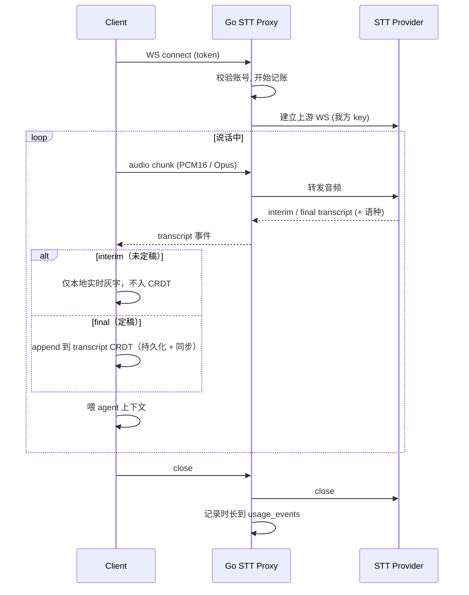

# 07 · STT 转发

[← 返回索引](../technical-plan.md)

用户自行配置 STT 服务困难，因此由后端统一持有厂商 key、按账号识别、为计费/限流留扩展点。这是后端唯一持有第三方 key 并可能产生成本的能力。

## 7.1 为什么走后端（而 LLM 不走）

| 对比 | STT | LLM |
| --- | --- | --- |
| 用户自配难度 | 高（实时流协议、鉴权复杂） | 低（填 baseURL + key 即可） |
| 密钥归属 | 我方（便于统一与计费） | 用户 |
| 成本控制 | 需按账号计量 | 用户自担 |
| 结论 | **后端转发** | **前端直连** |

## 7.2 上游选型（后端可插拔）

上游做成**后端可配置的多供应商**，由 `STT_PROVIDER` 切换，业务/前端不感知具体厂商：

- **Soniox**（当前前端原型所用）：中英混说（code-switching）、说话人分离强，契合 AGENTS.md「输出语言跟随用户主导口语」。
- **腾讯云 ASR**：中文场景强、国内低延迟/合规，按成本/地域可选。
- 备选：Deepgram（多语言实时、价格友好）、AssemblyAI、Gladia。
- 批量转写（非实时）场景可用 Groq 的 `whisper-large-v3`，但不适合边说边转。

> **实现约定**：`internal/stt/upstream.go` 定义统一接口，`internal/stt/soniox.go`、`internal/stt/tencent.go` 各实现之，`STT_PROVIDER=soniox|tencent` 在后端选择。切换只换实现、不动 `/stt` 协议与前端。
>
> **迁移现状**：未登录的本地模式仍是浏览器**直连 Soniox**（key 走 dev 编译期注入 `services/dev-keys.ts`，见 [soniox.ts](../../services/stt/soniox.ts)；旧 `/api/soniox-key` 已下线）。登录后音频经 `/stt` 后端转发，后端持有 key；前端采集/降采样/PCM16 编码逻辑复用，仅换传输目标与鉴权。

## 7.3 数据流



## 7.4 客户端采集

- `getUserMedia({ audio: true })` → `AudioWorklet` / `MediaRecorder` 取帧。
- 编码：优先 PCM16（16kHz 单声道）或上游支持的 Opus。
- 经 `/stt` WS 上行；接收 interim（灰字实时）+ final（定稿）。
- **持久化边界**：interim 仅渲染为本地实时灰字（本地态）；**final 段落 append 到 transcript CRDT**（模块 04 的 `transcript` 数组），从而与画布一起持久化、跨端同步、可就地编辑。
- transcript 文本同时作为 agent 的 `transcriptWindow`（见现有 `App.tsx` 用法）。

## 7.5 服务端消息（`/stt`）

```text
上行:
  binary  audio 帧
  {"type":"config","language":"auto","sampleRate":16000}  可选起始配置
  {"type":"stop"}

下行:
  {"type":"transcript","text":"...","final":false,"language":"zh"}
  {"type":"transcript","text":"...","final":true,"language":"zh"}
  {"type":"error","error":"..."}
```

## 7.6 记账与限流钩子

- 连接建立 → 记开始时间；关闭/超时 → 计算时长写 `usage_events(kind='stt', amount=秒)`。
- **限流/计费先埋点不启用**：预留 `checkQuota(userID)` 钩子，首版直接放行。
- 后期：按账号套餐做每日/每月配额与并发上限。

## 7.7 防护

- 连接必须鉴权（模块 03）。
- 单连接时长上限、音频码率/体积上限、空闲超时断开。
- 上游异常（限额/网络）→ 下行 `error` 事件，客户端优雅降级（停止录音、提示）。
- 上游 key 只存后端环境变量（如 `SONIOX_API_KEY` / 腾讯云 `TENCENT_SECRET_ID`+`TENCENT_SECRET_KEY`，按 `STT_PROVIDER` 选用），绝不下发客户端。运行时 `/api/soniox-key` key 下发已下线（仅保留 dev 编译期注入供本地浏览器直连）。

## 7.8 与 agent 的关系

STT 只产生「文字」。文字的润色/翻译/断句若需 LLM，属于**前端直连**（模块 08）；agent 消费转写文本作为上下文（模块 09）。后端不对转写文本做 LLM 处理。

## 7.9 实现现状（后端转发已落地）

服务端 `/stt`（WebSocket，`server-go/internal/stt/`）已实现，vendor 可插拔、前端不感知：

- `upstream.go`：`Upstream`/`Session` 接口 + vendor-neutral `Transcript{Text,Final,Language,Speaker}` + `Config`。
- `handler.go`：`/stt` 协议（上行 `{type:config}` + 二进制 PCM16 + `{type:stop}`；下行 `{type:transcript}` / `{type:error}`）。首个音频帧惰性开上游；单 writer goroutine（`pump`）把上游结果/错误下行；含 `checkQuota`（放行占位）与 `recordUsage`（记时长占位，模块 7.6）。
- `soniox.go`：Soniox 上游（后端持 `SONIOX_API_KEY`）。`parseSonioxMessage` 为**纯函数**，与前端 `soniox.ts` 同一套 token 分组（final 按说话人分段、interim 合并），已单测。
- `tencent.go`：腾讯云 ASR 占位实现（`STT_PROVIDER=tencent` 可选中）；签名 WS 流式层未实现，`Open` 返回明确错误——接口/配置已就位，补齐签名层后切换只改环境变量、不动 `/stt` 协议与前端。
- `mock.go`：`MockUpstream`（脚本化 transcript + 记录音频），供测试与 `STT_PROVIDER=mock` 本地开发（无需真 key）。
- 选择器 `STT_PROVIDER=soniox|tencent|mock`（`cmd/server/main.go` 的 `buildUpstream`）。
- 测试 `handler_test.go`：无 token 拒绝、mock 上游端到端（config→audio→收到 interim/final、音频确达上游）、上游开启失败下行 `error`；`soniox_test.go`：分组/错误/非 JSON/字符串说话人。

客户端 provider 已实现并**已接入运行时**（登录后 Transcript 用 `BackendSTT`，未登录回退浏览器直连 Soniox）：

- `services/stt/backend.ts`：`BackendSTT implements STTProvider`，复用 `PcmMicStream` 采集，`SttTransport`/`PcmSource` 注入式（协议逻辑可脱离真实 WS/麦克风测试）+ `websocketSttTransport(url)`。
- 测试 `backend.test.ts`：开连发 config + 泵音频、transcript 帧→`TranscriptEvent`、`error` 帧→`onError`、`stop()` 发停并拆除。
- ✅ 收尾完成：运行时 `/api/soniox-key` 已下线，本地浏览器直连改用 dev 编译期注入（`services/dev-keys.ts`）。
