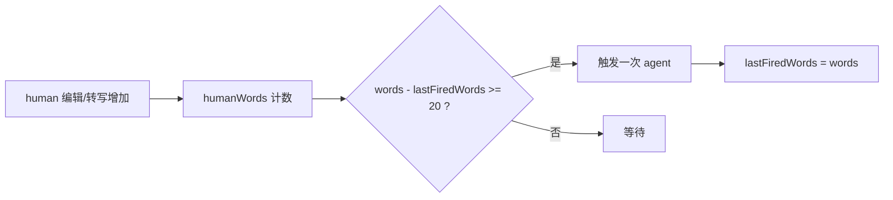
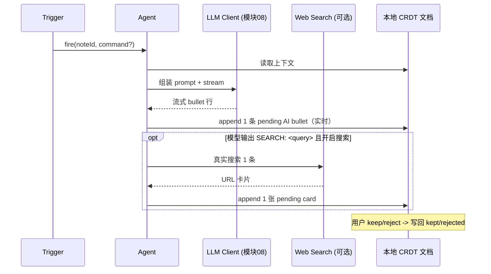

# 09 · Co-thinking Agent

[← 返回索引](../technical-plan.md)

co-thinking agent 是产品核心，**运行在客户端**。它读取本地 CRDT 文档与转写上下文，调用用户配置的 LLM（模块 08），产出相邻、可 keep/reject 的增量建议。

## 9.1 设计原则（对照 AGENTS.md）

- AI **延展而非覆盖**：只 append 增量，human bullet 恒为 kept，AI bullet 为 pending。
- 建议**相邻、视觉可区分、可 keep/reject**。
- 一次只产出**一个小增量**（≤ 14 词的单条 bullet），保持低打扰。
- 依据用户 `kept`/`rejected` 信号调整方向。

## 9.2 触发机制（沿用现有）

现有 `App.tsx` 逻辑：每当某 note 的 **human 字数增长 ≥ 20** 触发一次（`humanWords` + 每 note 的 `lastFiredWords`）。



- `lastFiredWords` 是**本地态**（不进 CRDT，见模块 04）。
- 也支持显式命令（`CommandBar` 的 Tier-3）：用户输入指令 → 立即触发一次。

## 9.3 上下文组装

agent 从本地 CRDT 文档 + 转写读取（无需后端往返）：

```ts
interface AgentContext {
  seedText: string          // 关键词或首条 human bullet
  contextNotes: string[]    // 本 note 的 human bullets
  transcriptWindow: string  // 来自 STT 的转写（模块 07）
  kept: string[]            // 正反馈
  rejected: string[]        // 负反馈
  existingIdeas: string[]   // 已在画布上的 AI bullets + card 标题（避免重复）
  command?: string          // 显式命令（Tier-3）
}
```

对应现有 `services/llm/cocreate-types.ts` 的 `CocreateRequest`，去掉 `provider`/`openSub`（改由客户端 provider 配置决定，模块 08）。

## 9.4 执行流程



## 9.5 反馈闭环

- keep：AI bullet/card `status -> kept`，文本加入 `kept`（`Y.Array`）。
- reject：移除该 bullet/card，文本加入 `rejected`（`Y.Array`）。
- 下次触发时 `kept`/`rejected` 进入 prompt，方向逐步收敛（现有 `COCREATE_SYSTEM` 已含「偏向 kept、避开 rejected」）。

## 9.6 与运行位置相关的注意

- **并发/节流**：客户端每 note 维护 `aiRunning`（本地态），运行中不重复触发。
- **多设备**：agent 在"当前活跃客户端"运行；其产出的 AI bullet 通过 CRDT 同步到其他设备。为避免多端重复触发，可约定「仅前台/焦点窗口触发」或加轻量本地锁（后期）。
- **离线**：只要能连到用户配置的 MaaS 即可产出；完全离线时仅停用 agent，笔记编辑不受影响。

## 9.7 代码落点

- 触发器与编排：保留在客户端（由 `App.tsx` 的 `runAi`/触发 `useEffect` 演进，迁入 `packages/core/agent`）。
- LLM 调用：走模块 08 的 provider 直连。
- 产出写入：写入 CRDT 文档（模块 04），而非当前的 `setNotes`。
