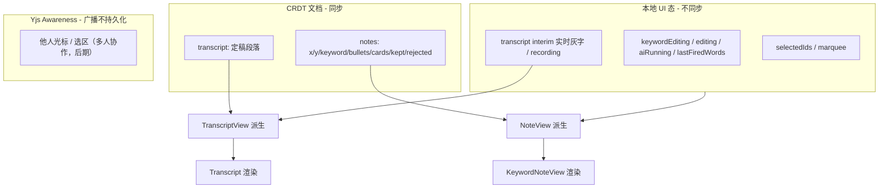

# 10 · 前端画布与状态重构

[← 返回索引](../technical-plan.md)

保留现有画布交互与视觉，把底层状态从 React `useState` 迁到 **Yjs 文档派生 + 本地 UI 态叠加**。

## 10.1 现有交互（保留）

来自 `App.tsx` / `KeywordNoteView.tsx`：

- 从左侧 transcript 拖拽短语到画布 → 新建 note。
- 空白点击 → 新建 note；拖拽空白 → 框选。
- human bullet 可编辑、恒为 kept；AI bullet pending，可 ✓/✕。
- URL 卡片 hover 可 keep/reject。
- 底部命令栏（Tier-3 显式命令）。

这些交互**不变**，只改数据来源。

## 10.2 状态分层



## 10.3 绑定层设计

新增 `packages/core/doc` 提供 React 绑定：

```ts
// 打开/创建一个 board 文档（含 transcript + notes）
const doc = openBoard(docId)              // Y.Doc + 本地持久化 + 同步 provider

// React hooks：订阅 CRDT，产出派生视图
const notes = useBoardNotes(doc)          // 内部用 doc.observeDeep -> setState
const transcript = useTranscript(doc)     // 定稿段落（不含 interim）

// 笔记变更 API（写 CRDT）
board.addNote({ x, y, keyword, srcSeg })  // srcSeg 溯源到 transcript 段落
board.updateNoteKeyword(noteId, text)
board.appendBullet(noteId, { origin, text, status, fireId })
board.keepBullet(noteId, bulletId)
board.rejectBullet(noteId, bulletId)
board.appendCard(noteId, card)

// transcript 变更 API（写 CRDT）
board.appendSegment({ id, text, tStart, tEnd, lang })  // STT final 定稿时调用
board.editSegment(segId, text)                          // 就地纠错
board.setSegmentMarks(segId, marks)                     // 关键词高亮范围
```

- 本地 UI 态仍用 React `useState`/`useReducer`，与派生的 `NoteView` 合并渲染。
- `App.tsx` 中现有的纯 UI 逻辑（拖拽、框选、就地编辑的 open/close）保留在本地态层。

## 10.4 改造对照表

| 现有（`App.tsx`） | 改造后 |
| --- | --- |
| `const [notes, setNotes] = useState<KeywordNote[]>([])` | `const notes = useBoardNotes(doc)`（派生） |
| `setNotes(ns => ...)` 内容变更 | 调 `board.*` 写 CRDT |
| `keywordEditing/editing/aiRunning` 混在 note 里 | 拆到本地 UI 态 |
| `runAi` 内 `setNotes` 追加 AI bullet | `board.appendBullet(...)`（模块 09） |
| `TRANSCRIPT_TEXT` / `LINES` 静态 | transcript 定稿段落来自 CRDT（`useTranscript`），interim 来自本地态 |

## 10.5 转写面板（Transcript）改造

- `Transcript.tsx` 从静态 `LINES` 改为**双来源渲染**：
  - **定稿段落**：来自 CRDT `transcript`（持久化 + 同步，刷新/换端仍在）。
  - **interim 实时灰字**：来自本地态（STT 未定稿，不入 CRDT）。
- STT `final` 事件 → `board.appendSegment(...)` 写入 CRDT（模块 07）。
- **就地编辑**：点击段落编辑 → `board.editSegment(...)`（沿用现有 "Edit transcript sections in place"，底层改写 CRDT）。
- 「短语拖拽到画布」：从段落切分出可拖拽片段，落到画布时带上 `srcSeg` 溯源（`board.addNote({ ..., srcSeg })`）。
- 关键词高亮（现有 `<mark className="kw">`）→ `marks`，由客户端规则或 agent 标注（后期），存 `board.setSegmentMarks(...)`。

## 10.6 多 board 与导航

- 顶部/侧边增加 board 列表（来自后端 `GET /documents`）。
- 每个 board 对应一个 Yjs 文档与同步连接；切换 board 即切换文档。

## 10.7 打包目标

- `apps/web`：Vite 构建 + PWA（离线可用，配合本地持久化）。
- `apps/desktop`：Electron（模块 11）。
- 共享 `packages/core`（CRDT/agent/LLM/类型）。
