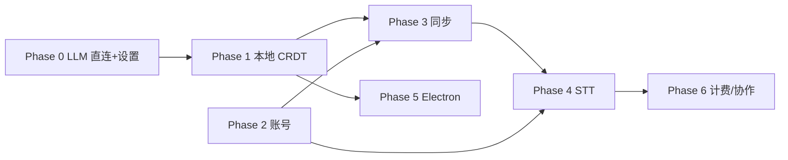

# 12 · 路线图与安全

[← 返回索引](../technical-plan.md)

## 12.1 分阶段路线图

| 阶段 | 内容 | 涉及模块 | 产出/验收 |
| --- | --- | --- | --- |
| Phase 0 | Monorepo 重构 + 抽 `packages/core`；LLM 迁到客户端直连；下线 dev API 插件；设置/密钥 UI | 08, 10 | 单机可用（用户自带 key），刷新前不丢当前会话 |
| Phase 1 | 本地优先持久化（Yjs + y-indexeddb），笔记状态重构为 CRDT | 04, 05, 10 | 刷新不丢、离线可编辑 |
| Phase 2 | Go 后端：Auth + 账号体系 | 03, 06 | 可注册/登录/刷新令牌 |
| Phase 3 | Go 同步服务（WS 中继 + update 日志 + 快照） | 05, 06 | 两台设备实时同步同一 board |
| Phase 4 | Go STT 转发 + 真实 transcript 面板 | 07, 10 | 实时语音转写并驱动 agent |
| Phase 5 | Electron 打包多端 + 安全密钥存储 | 11 | 可安装桌面客户端 |
| Phase 6（后期） | 计费/限流启用、可选计费搜索、多人实时协作 | 05, 07, 08 | 商业化与协作能力 |

### 阶段依赖

- Phase 0/1（前端）与 Phase 2（后端账号）可并行。
- Phase 3 需要 Phase 1（CRDT）与 Phase 2（账号）都就绪。

## 12.2 安全清单

- **密钥归属**
  - 用户 LLM/搜索 key 绝不出客户端（Electron `safeStorage` / Web IndexedDB）。
  - 只有走后端的计费型服务（STT / 可选搜索）用我方 key，且只存后端环境变量。
- **鉴权**
  - 所有后端 REST/WS 均需 token；WS 用 subprotocol 传令牌（模块 03）。
  - refresh token 轮换 + 复用检测 + 可撤销。
- **授权**
  - 同步/文档接口按 `owner_id` 与 `document_collaborators` 校验归属。
  - 广播仅在同 `docId` 已授权连接间进行。
- **STT 防护**
  - 连接鉴权、时长/体积上限、空闲超时、用量记账（`usage_events`）。
- **传输**
  - 全链路 HTTPS/WSS。
- **CORS**
  - Web 版对个别 MaaS 受限（产品定位取舍），Electron 无此问题。
- **数据格式演进**
  - CRDT `meta.schemaVersion` 版本化，提供迁移函数。

## 12.3 与产品约束的一致性核对（AGENTS.md）

| 约束 | 落地方式 |
| --- | --- |
| AI 延展而非覆盖人类内容 | agent 只 append 增量；human bullet 恒 kept；AI bullet pending 可 keep/reject（模块 09） |
| 输出语言跟随用户主导口语 | STT 自动语种（模块 07）+ LLM 提示词沿用（模块 08） |
| AI 建议相邻、可区分、可 keep/reject | 沿用 `KeywordNoteView` 交互，底层改 CRDT 派生（模块 10） |
| URL 卡片只来自真实搜索 | 保持真实搜索（用户 key / 后期计费转发，模块 08） |

## 12.4 风险与缓解

| 风险 | 影响 | 缓解 |
| --- | --- | --- |
| Web 版 MaaS CORS 受限 | 部分 provider 前端不可直连 | 引导 Electron；提供 OpenAI 兼容网关选项 |
| Go 侧手写 Yjs 同步协议复杂 | 开发成本/正确性 | 采用「哑中继」不解析 CRDT；必要时切 y-sweet/Hocuspocus |
| 多实例 WS 广播 | 水平扩展受限 | docId 一致性哈希路由 / Redis pub/sub（模块 05） |
| STT 成本失控 | 费用 | 首版记账埋点，Phase 6 启用配额/限流 |
| 客户端多端重复触发 agent | 重复建议/费用 | 仅焦点窗口触发 + 本地锁（模块 09） |
| 密钥在 Web 端泄露风险 | 安全 | 明确提示；推荐 Electron；支持 session-only 模式 |
